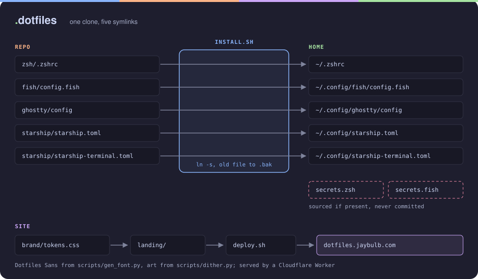

# dotfiles

Shell and terminal config for macOS (Apple Silicon or Intel).

Site: https://dotfiles.jaybulb.com



## What's here

- `zsh/.zshrc` - PATH, aliases, completions, tool init
- `fish/config.fish` - same setup for fish, plus git abbreviations
- `ghostty/config` - Ghostty terminal (JetBrainsMono Nerd Font, launches fish)
- `starship/` - Starship prompt (Catppuccin Mocha powerline, plus a plain variant for Terminal.app)

## Install

```bash
git clone https://github.com/nulljosh/dotfiles.git ~/Documents/Code/dotfiles
cd ~/Documents/Code/dotfiles
brew install fish starship eza bat fd fzf zoxide atuin fnm
brew install --cask font-jetbrains-mono-nerd-font ghostty
./install.sh
```

`install.sh` symlinks each file into place and backs up anything it replaces as `*.bak`. Missing tools are skipped, not errors.

On an older Intel Mac Homebrew has no bottles and builds fish and starship from source (hours, via llvm and rust). Use the official release builds instead: `fish.app` into `~/Applications` with its `fish` linked into `~/.local/bin`, and the starship, bat, fd, zoxide and fzf release binaries into `~/.local/bin`. Both shells and Ghostty put `~/.local/bin` on PATH.

## Site

https://dotfiles.jaybulb.com is a Cloudflare Worker serving `landing/`. `./deploy.sh` copies the brand files in and publishes it (needs `npx wrangler login` once).

- `brand/` - the brand kit: `tokens.css` (the single source for colour, type and space), `mark.svg`, `BRAND.md`. Live at `/brand`.
- `scripts/gen_font.py` - builds Dotfiles Sans: Inter (OFL) with every dot redrawn as a circle.
- `scripts/dither.py` - dithers the public domain art (Janus, Velazquez's Forge of Vulcan) into the masks in `landing/art/`.

## Secrets

API keys go in `~/.config/zsh/secrets.zsh` and `~/.config/fish/secrets.fish`. Both are sourced if present and never committed.

## Roadmap

- [ ] Social card: an `og:image` PNG (mark, headline, powerline stripe) and an `apple-touch-icon`.
- [ ] Brand kit: downloadable PNG sizes of the icon (16 to 1024) next to the SVGs.
- [ ] Hero: real-browser QA of the new terminal layout and rolling scanlines on mobile Safari.
- [ ] atuin and eza on macOS 13 Intel: no bottles or macOS release builds; install with `cargo install` once Rust is set up.
- [ ] Verify a fresh clone on Apple silicon end to end (`install.sh`, Ghostty opening fish with the Starship prompt).

## License

MIT 2026 Joshua Trommel
